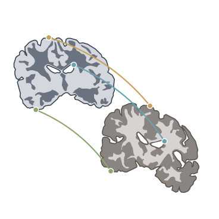
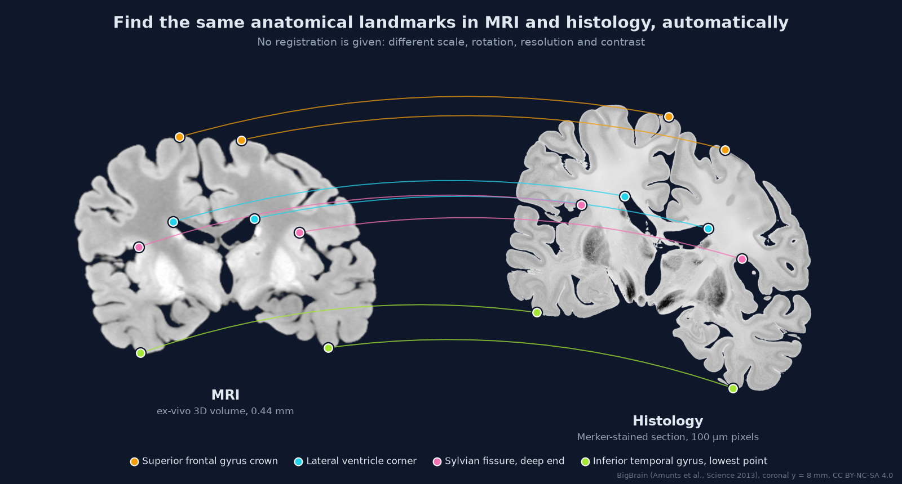

> **Workstation setup and current handoff:** [LINUX_SETUP.md](LINUX_SETUP.md).
> Detailed project record: [PROJECT_PATH.md](PROJECT_PATH.md); pitfalls: [FOUNDATIONS.md](FOUNDATIONS.md).

<p align="center">
  
</p>

<h1 align="center">X Marks the Spot</h1>

<p align="center">
  <b>Automatic landmarks for unregistered MRI and histology.</b><br>
  Find the same anatomical spot in both images, without registering them first.
</p>



<sub>
<b>The goal in one picture.</b> Left: a coronal slice of BigBrain's ex-vivo MRI. Right: the matching BigBrain
histology section, rotated and rescaled the way real data arrives. Each coloured pair is one anatomical landmark
found in both images. The method we build should produce pairs like these without being told how the two images
line up. The pairs in this figure were picked by hand from BigBrain's released alignment, for illustration only.
</sub>

## The project

Landmarks are the usual starting point for MRI–histology registration. Today, researchers place corresponding
landmarks by hand in the MRI volume and in each histological section before registration can begin. This takes a
long time, and the result depends on the person's experience.

**Goal:** develop a method that automatically finds corresponding anatomical landmarks in unregistered MRI and
histology images.

- Build a first method that finds candidate landmarks, using classical image processing or image embeddings.
- Show the landmarks in MRI and histology side by side.
- **First milestone:** a working proof of concept within two days.

**You need:** basic Python and image processing (or the will to learn), and minimal brain anatomy (or the will to learn).

## Why this is hard

| | MRI | Histology |
|---|---|---|
| Dimensions | 3D volume | 2D section; its position and angle in the MRI are unknown |
| Resolution | ~0.4–1 mm | 0.25–20 µm in-plane (BigBrain: 20 µm; downsampled here to 100–200 µm) |
| Contrast | ex-vivo: grey matter brighter than white matter | Nissl/Merker stain: grey matter darker than white matter |
| Geometry | intact brain | shrinkage, tears, folds; sulci often open that are closed in MRI |

Intensities do not map one-to-one between the two modalities, so plain feature detectors (SIFT, ORB) on raw
intensities usually find few true matches. Shape, layout and anatomy are shared; intensity is not.

## Data: BigBrain

[BigBrain](https://bigbrainproject.org) (Amunts et al., 2013) is one human brain, sectioned at 20 µm and
reconstructed in 3D. Its 2015 release includes an ex-vivo MRI of the same brain, aligned to the histology volume.
Both volumes share one world coordinate system (RAS, in mm). **This gives free ground truth:** cut both volumes at
the same coordinate, distort the histology slice with a transform you choose, and you know where every landmark
must land.

| File | Size | What |
|---|---|---|
| `mri_to_blk_aligned.nii.gz` | 33 MB | ex-vivo MRI, 0.444 mm isotropic |
| `full8_200um_optbal.nii.gz` | 78 MB | histology volume, 200 µm (start here) |
| `full8_100um_optbal.nii.gz` | 602 MB | histology volume, 100 µm (optional, sharper) |

```bash
mkdir -p data/bigbrain && cd data/bigbrain
BB=https://ftp.bigbrainproject.org/bigbrain-ftp/BigBrainRelease.2015
wget $BB/3D_MRI/nii/mri_to_blk_aligned.nii.gz
wget $BB/3D_Volumes/Histological_Space/nii/full8_200um_optbal.nii.gz
# optional: wget $BB/3D_Volumes/Histological_Space/nii/full8_100um_optbal.nii.gz
```

Things to know before loading:

- Both files load with `nibabel` as RAS volumes with diagonal affines. A coronal slice at world `y` mm is index
  `j = round((y - affine[1, 3]) / affine[1, 1])` on the second axis.
- The histology is tissue dark on a white background. The 8-bit file stores a scale factor, so `nibabel` returns
  values from 0 to 65535; background is 65535.
- Do not use `Raw_Data/MRI/mri_to_blk*.mnc` from the FTP site. That MRI is aligned to the block faces, not to the
  final histology.

## Proof-of-concept plan (two days)

**Day 1: data and an evaluation harness**

1. Load both volumes and cut the same coronal slice from each (they are already aligned).
2. Make "unregistered" test pairs: apply a random rotation, scale and shift to the histology slice. Keep the
   transform, so the true position of every point is known. Later add flips, crops and out-of-plane tilt.
3. Run first landmark detectors on each image separately.

**Day 2: matching and visualisation**

4. Match landmarks across the two images. Reject wrong matches with a geometric check (for example RANSAC with a
   similarity or affine model).
5. Draw the matched pairs side by side, like the figure above, and report the numbers below.

**Stretch goal:** the real problem is 2D to 3D. Given one histology section, find the plane in the MRI volume that it
came from, then find the landmarks.

## How we measure success

- **Landmark error:** distance in mm between each matched MRI point and the true position of its histology partner.
  Report the share of pairs within 2 mm and within 5 mm.
- **Chance level:** the same numbers for random pairs. A method must clearly beat it.
- **Number and spread of correct pairs:** a registration needs several pairs that do not lie on one line.
- **Transform recovery:** fit a transform to the matched pairs and compare it with the planted rotation and scale.

## Ideas to try

Classical image processing:

- **Shape landmarks from masks.** Threshold tissue against background in both images. The outline is visible in
  both modalities. Take extreme points: gyral crowns (local maxima of the outline), deep ends of large sulci,
  corners of the lateral ventricles, the midline.
- **Make the images look alike first.** Invert one image, match histograms, or segment both into background, grey
  matter and white matter, and then compare the label images instead of raw intensities.
- **Modality-independent descriptors.** MIND / MIND-SSC, gradient orientation (HOG), local self-similarity, phase
  congruency.
- **Contour matching.** Shape context or curvature along the outline.

Image embeddings:

- **Dense features from pretrained vision models** (for example DINOv2). Compare patch features of the two images and
  keep mutual nearest neighbours as candidate pairs.
- **Learned matchers** (SuperPoint + LightGlue, LoFTR). They are trained on photographs; test whether they transfer
  to MRI against histology.

Whatever the features, a robust matching step helps: mutual nearest neighbours, a ratio test, RANSAC, and a
left/right consistency check.

## Notes from earlier tests

- On BigBrain in 3D, gyral crowns detected as local extrema of the outer brain surface matched between histology and
  MRI for about half of the points (52% within 2 mm; random pairing gives about 1%).
- Deep points of sulci matched only where the sulcus is open in both images. Ex-vivo MRI often shows a sulcus
  closed where the histology shows it open.
- On another specimen, raw-intensity correlation and 3D SIFT did not link Nissl histology to MRI. Start from shape,
  or make the images look alike first.

## Output format (proposal)

One CSV per image pair, so any registration pipeline can read it:

```
id, name, mri_x_mm, mri_y_mm, mri_z_mm, hist_col_px, hist_row_px, score
```

MRI coordinates are world mm. Histology coordinates are pixel positions on the section image.

## Repository layout

```
automated_landmarks/
├── assets/            logo and README figure
├── data/              downloaded data (not in git)
├── landmarks/         Python package: detection, matching, evaluation
├── notebooks/         exploration
├── results/           outputs of runs (not in git)
├── scripts/           command-line entry points
└── requirements.txt
```

## Getting started

```bash
git clone <this repository>
cd automated_landmarks
python -m venv .venv && source .venv/bin/activate
pip install -r requirements.txt
# download the BigBrain files into data/bigbrain (see "Data" above), then check that they load:
python -c "import nibabel as nib; [print(f, nib.load('data/bigbrain/' + f).shape) for f in ('mri_to_blk_aligned.nii.gz', 'full8_200um_optbal.nii.gz')]"
```

If the last command prints `(315, 362, 284)` for the MRI and `(696, 770, 605)` for the histology, your data and
environment are ready.

## Credits and licence

- BigBrain data: Amunts K, Lepage C, Borgeat L, et al. *BigBrain: an ultrahigh-resolution 3D human brain model.*
  Science 340(6139):1472–1475, 2013. [doi:10.1126/science.1235381](https://doi.org/10.1126/science.1235381).
  Licensed under [CC BY-NC-SA 4.0](https://creativecommons.org/licenses/by-nc-sa/4.0/).
- The images in `assets/` (figure and logo) are derived from BigBrain data and are shared under the same licence,
  CC BY-NC-SA 4.0.
- Code licence: to be decided.
